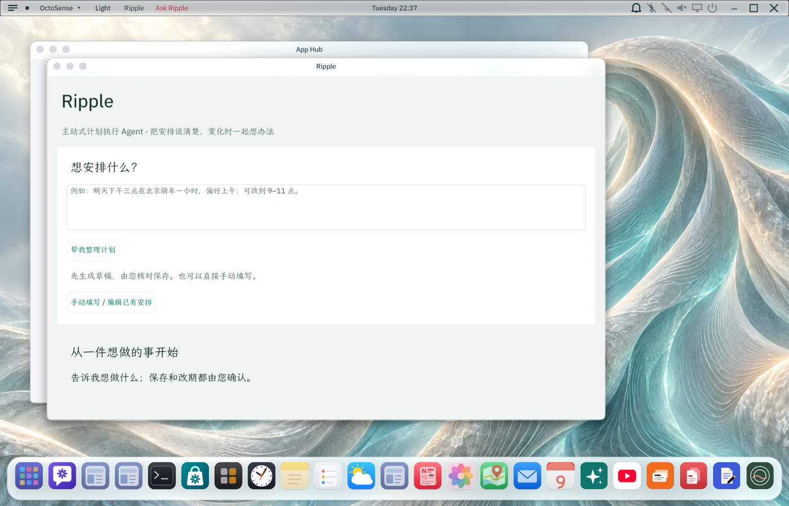
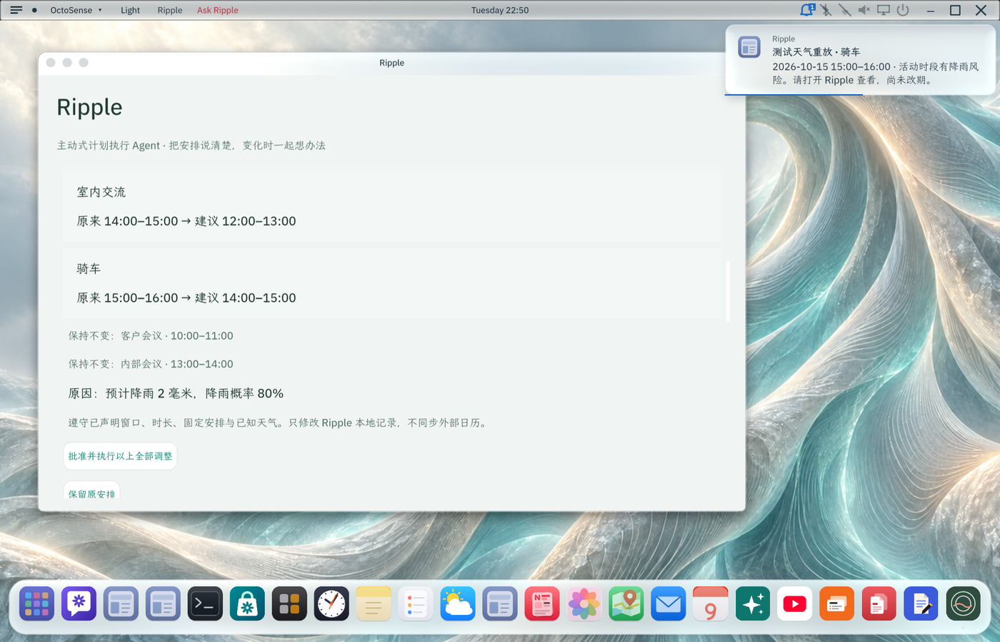
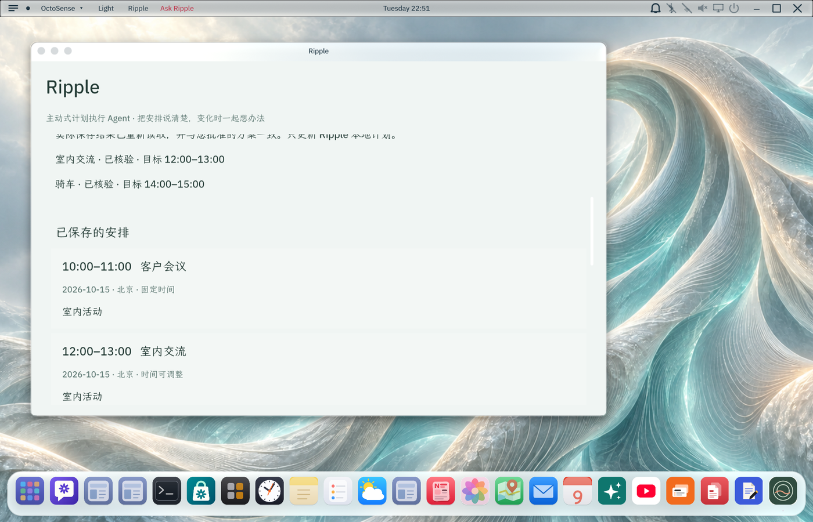

# Ripple · 主动式计划执行 Agent

告诉 Ripple 想做什么；它理解安排、检查日程冲突和天气风险，提出可行调整，等您批准后真正保存，并独立读回核验。

当前正式发布版本为 **0.6.4**，唯一原生应用入口是 [`bundle/main.splash`](bundle/main.splash)。这是 OctoScript / Splash 应用，运行于官方 OctoSense Windows RC6。GitHub 认证 Release 和正式下载包复验已完成。App Hub 审核和赛事新截止资格尚未确认；发布不代表上架或获奖。`v0.1.0` 保留原比赛提交，后续代码不代表截止日成绩。

**[下载认证发布包](https://github.com/yuandhsh-lang/ripple/releases/tag/v0.6.4) · [114秒真实软件演示](https://github.com/yuandhsh-lang/ripple/releases/download/v0.6.4/Ripple-0.6.4-Real-Demo.mp4) · [正式交付核验](docs/release/FINAL_DELIVERY.md)**

应用固定 Commit：`7e150404a3073a77688d5e1670de018083fe82a4`，Tag `v0.6.4`。演示来自实际下载包；天气风险变化明确标记为受控重放，DeepSeek、通知、审批、执行与读回均为真实软件运行。B站使用相同视频，由用户自行上传。

## 一件真实任务

您安排北京骑行，又加入固定会议。Ripple 在保存后检查重叠和对应时段天气，只分析相关安排。找不到合法时段时，AI 说明原因，请您确认是否调整允许窗口；确认条件后重新规划。**确认条件不是批准改期**：您仍须核对原时间、新时间和整个变更集合，再批准执行。

执行结果只在持久化记录与批准结果相符时显示“已独立核验”。拒绝不会改期；部分完成、失败、未知结果分别显示，重启后只读核对，不重放批准。

## 实际能力与边界

- 自然语言生成可编辑中文草稿，确认城市和时间后保存；也保留手动编辑。
- 一个主活动和最多四项同城同日关联计划；固定会议不动，优先减少改动，再比较已声明偏好与时间位移。
- Open-Meteo 真实城市搜索和逐小时降雨预报；缺失、过期、位置不匹配不视为安全。
- 启动、保存、刷新天气或明确分析时检查重要变化。官方 Glance 请求卡片和宿主桌面提醒；不会全天后台监控。
- 一个宿主 Agent，两个只读工具：读取已验证上下文、搜索合法候选。AI 解释和选择，确定性代码校验；异常时明确规则降级。
- 无解协商与最多一次定向纠正；任何未通过校验的选择都不能进入执行审批。
- 整组审批、版本绑定、唯一写入口、逐项收据、独立读回与中断恢复。

仅支持 Windows、`Asia/Shanghai`、同日、15–240 分钟。搜索最多同时移动主活动及一项关联安排，不声称全局最优。仅管理 Ripple 内部计划，**没有外部日历同步**。暖启动通知可能需在应用内点击“查看系统提醒状态”；历史 SDK 间歇时间预算问题尚未完全归因。[完整限制](docs/release/KNOWN_LIMITATIONS.md)。

## 安装与验证

请先阅读 [独立复现指南](docs/release/REPRODUCTION.md)。公开发布前不要把本地演练包当作认证包。发布后以 GitHub Release 的 `app.bundle.pack.json`、GitHub Actions 来源证明和校验值为准，不能仅下载源码 ZIP 代替安装包。

模型通过宿主设置授权；需要自己的可用 Provider。密钥不在本仓库或 Bundle 中。城市名称和坐标用于 Open-Meteo；允许 AI 后，相关计划与天气事实会发送给所选 Provider。[隐私](PRIVACY.md) · [支持](SUPPORT.md) · [安全与验收](docs/release/VALIDATION.md) · [发布流程](docs/release/RELEASING.md)。

## 实际应用画面

下列画面来自相同业务源码的官方 RC6 实机验收，不是概念图。正式下载包已在两个独立空 RC6 环境真实安装并完成核心任务。唯一正式视频为114秒的真实GPU窗口录屏；历史视频不作为新版证明。

## 工程与开源

Apache-2.0，见 [LICENSE](LICENSE) 和 [NOTICE](NOTICE)。原生交付以根 `bundle/` 为准；`src/` 与 npm 构建是保留的早期 React 原型，`stage1/bundle/` 是阶段历史快照，不是第二个发布入口。开发与测试说明见 [DEVELOPMENT.md](DEVELOPMENT.md)。
