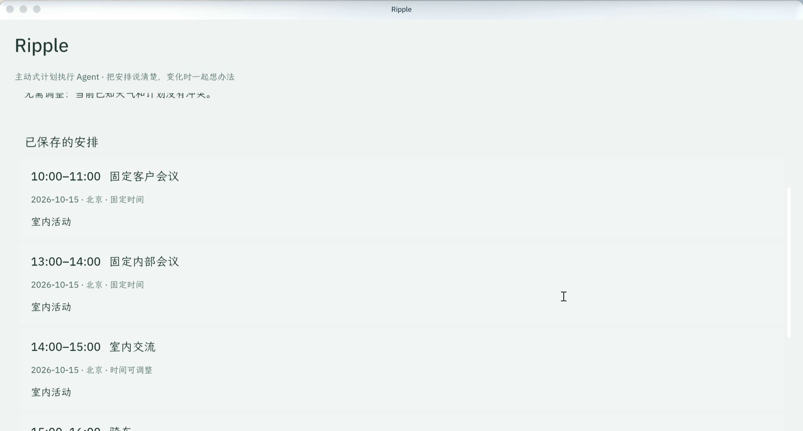
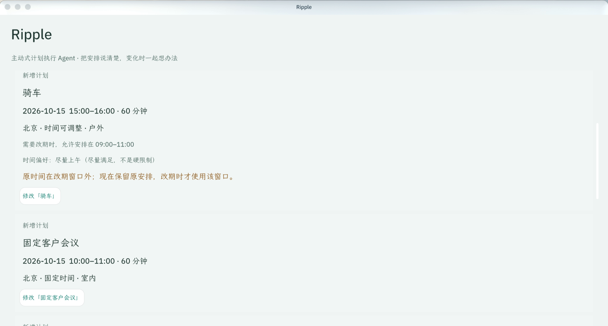
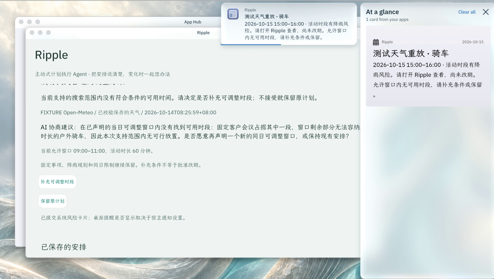
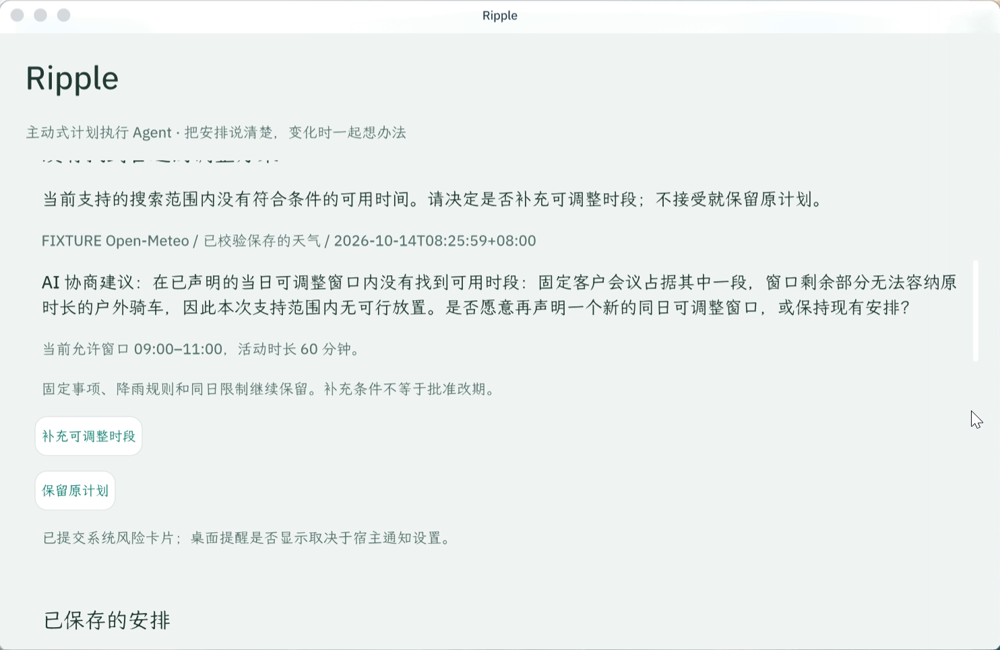
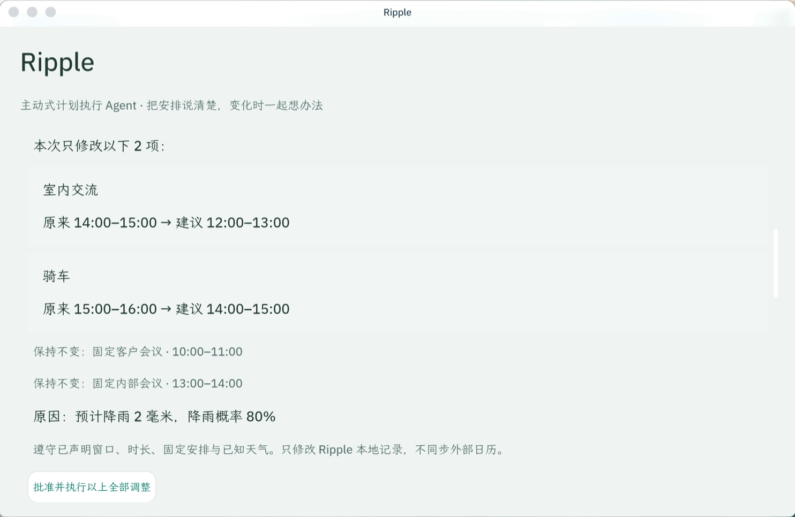
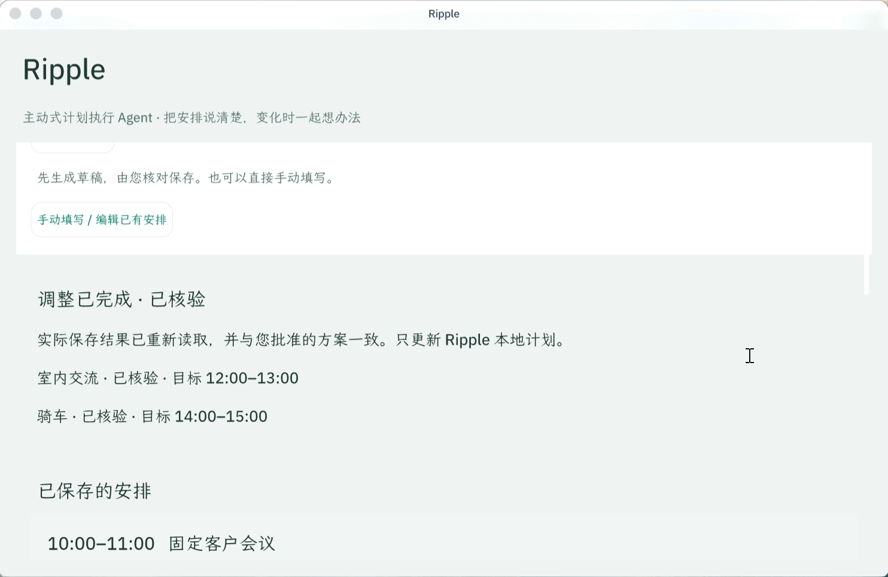

# Ripple — 主动式计划 Agent

计划变了，和 AI 一起找到可行安排。Ripple 检查日程与天气风险，提出调整，经您批准后改期，并重新读取保存结果。

**[观看 v0.6.4 历史演示（105 秒）](https://github.com/yuandhsh-lang/ripple/releases/download/v0.6.4/Ripple-0.6.4-Product-Demo-HQ.mp4) · [下载 v0.6.5](https://github.com/yuandhsh-lang/ripple/releases/tag/v0.6.5) · [安装与快速体验](docs/release/REPRODUCTION.md)**

- **说清安排。** 自然语言生成中文草稿，确认城市、时间和可调整条件后保存，也支持手动编辑。
- **发现变化。** 在打开应用、保存计划和刷新天气时检查冲突与降雨风险，通过原生 Glance 提醒您处理。
- **批准后落实。** AI 用工具寻找方案；无解时协商新条件。实际改期须单独审批，逐项写入并独立读回。

**v0.6.5 新增：** 导入 ICS 日历，让规划避开已有会议；打开“执行历史”，查看最近的批准、改期与核验结果。外部日历是只读快照，不会被 Ripple 改写。

## 一次计划协调

明天下午在北京骑行，但天气预报出现降雨；上午又有不能移动的会议。Ripple 发现原窗口内没有合法时段，询问是否愿意补充允许的时间。

您确认新的窗口后，AI 重新规划：把交流提前到中午，骑行改到下午两点，两场固定会议保持不变。核对两项变更并批准后，Ripple 保存调整，显示各项核验结果，撤回风险提醒。

**同意新条件不等于批准改期。** AI 建议、用户授权、实际执行和读回结果分别呈现。

## 工作原理

`计划与天气 → 变化检查 → Agent 调用只读工具 → 约束校验 → 用户审批 → 写入与读回`

一个宿主 Agent 使用两个工具：读取相关计划和天气事实，搜索满足约束的候选。确定性代码检查时间窗口、时长、固定安排、版本及天气覆盖；模型负责理解、解释和选择。任何未通过检查的建议都不能进入执行审批。

合法方案优先减少变更，再比较用户已声明的偏好与调整幅度。不需要调整时保留原计划；没有候选时说明原因，不凭空添加可用时间。

## 安装与第一次使用

1. 使用 Windows 官方 [OctoSense RC6](https://github.com/OctoSense-org/OctoSense/releases/tag/desktop-v0.1.0-rc.6)。这是已验证的预发布宿主版本。
2. 从 [Release](https://github.com/yuandhsh-lang/ripple/releases/tag/v0.6.5) 下载 `app.bundle.pack.json`，按 [复现指南](docs/release/REPRODUCTION.md) 验证来源并安装。App Hub 收录前使用官方隔离镜像流程。
3. 在宿主配置自己的 DeepSeek Provider，授权 Ripple 后输入需求；没有模型时仍可手动建立计划、使用规则分析。
4. 核对中文草稿，搜索并选择城市，明确保存。后续风险会在受支持的检查时机出现。

模型密钥由宿主管理。城市搜索和天气访问使用 Open-Meteo；授权 AI 后，相关计划、约束与天气事实发送给所选 Provider。[隐私说明](PRIVACY.md) · [问题反馈](SUPPORT.md)。

## 应用画面

以下为 v0.6.4 历史核心流程画面；不作为新增 ICS 和历史功能的证明。v0.6.5 的正式包实测媒体将在 Release 后补充，并记录版本对应关系。演示先读取 LIVE 天气，再用标为 FIXTURE 的快照验证降雨变化；模型、工具、Glance、审批、保存和读回来自同一次任务。

| 已保存的安排 | 中文草稿 |
|---|---|
|  |  |
| 原生风险提醒 | 无解时协商 |
|  |  |
| 整组变更审批 | 独立读回结果 |
|  |  |

## 复现与安全

[安装及任务复现](docs/release/REPRODUCTION.md) · [版本与媒体校验](docs/release/PRESENTATION.md) · [验收记录](docs/release/VALIDATION.md) · [审核回答](review/ANSWERS.md)

批准绑定完整变更与计划版本；陈旧批准、重复请求不能再次写入。执行过程中逐项记录收据，只有持久化读回匹配才显示已核验。部分完成或结果未知时停止进一步操作，重启只读核对，不自动重放旧批准。

## 支持范围

- `Asia/Shanghai`，同城同日，活动 15–240 分钟；一个主活动、最多四项关联计划，单次最多移动两项。
- 管理 Ripple 内部计划；可导入最多 32 项、32 KiB 的 ICS 只读占用，不做日历账户同步；关闭应用后不监测。
- 天气缺失、过期或位置不匹配时显示未知，不当作安全。
- 宿主提醒受系统通知设置影响；暖态 Glance 路由可能需要额外点击“查看系统提醒状态”。

详见 [已知限制](docs/release/KNOWN_LIMITATIONS.md)。发布包验证、App Hub 审核与赛事评审是不同状态，不以 GitHub Release 代表官方收录。

## 仓库导航与许可

| 目录 | 用途 |
|---|---|
| `bundle/` | 唯一正式 OctoScript / Splash 应用，包含 Agent、工具与资源 |
| `docs/` | [使用、架构、复现与验证索引](docs/README.md) |
| `review/` | 官方扫描回答与审核材料 |
| `src/`、npm 工程 | 保留的早期 React 原型，不是原生应用入口 |
| `stage1/`–`stage4/`、`phase*/` | 历史实现与验证资料，不作为新的发布入口 |

新版应用固定在 [`v0.6.5`](https://github.com/yuandhsh-lang/ripple/tree/v0.6.5)，完整 Commit 由 Tag 和 Release 收据共同核对。旧 `v0.6.4` 及其媒体保留。`main` 的文档和媒体可以后续修订，签署 Bundle 不变；历史 `v0.1.0` 和比赛材料保留。[文档勘误](docs/release/ERRATA.md)。

Apache-2.0，见 [LICENSE](LICENSE) 和 [NOTICE](NOTICE)。开发环境与测试命令见 [DEVELOPMENT.md](DEVELOPMENT.md)。
