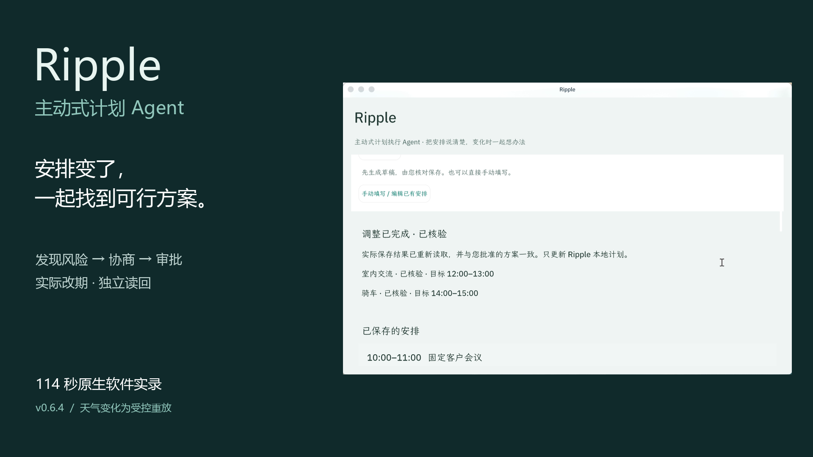

# v0.6.4 产品演示与校验清单

本页记录 2026-10-14 新录制的产品演示。它使用已下载的 **v0.6.4 认证发布包**；应用文件、Tag 和来源证明不变。新媒体独立上传，旧视频保留为历史记录。

## 观看与下载

**[观看 114 秒真实软件演示](https://github.com/yuandhsh-lang/ripple/releases/download/v0.6.4/Ripple-0.6.4-Product-Demo.mp4)**

- MP4：`Ripple-0.6.4-Product-Demo.mp4`，114.000 秒，1920×1080，H.264，30fps；AAC 中文解说与烧录中文字幕。
- 大小：3,907,838 字节。
- SHA-256：`c136c8059f38d16258512f7cc15dbe6c06e2f94750443cffced7bb9b84c4f7ab`
- [封面 PNG](https://github.com/yuandhsh-lang/ripple/releases/download/v0.6.4/Ripple-0.6.4-Product-Cover.png)
- [真实截图目录](../media/) · [截图下载](https://github.com/yuandhsh-lang/ripple/releases/download/v0.6.4/Ripple-0.6.4-Product-Screenshots.zip)
- [B站投稿文案](BILIBILI.md)：与 App Hub 使用同一 MP4；由使用者自行上传，未声明任何 BV 号。

## 版本与来源

| 项目 | 固定值 |
|---|---|
| App / Tag | `0.6.4` / `v0.6.4` |
| 应用 Commit | `7e150404a3073a77688d5e1670de018083fe82a4` |
| 官方宿主 | Windows `desktop-v0.1.0-rc.6`，未修改 |
| [GitHub Actions](https://github.com/yuandhsh-lang/ripple/actions/runs/38481044405) | 发布与 Attestation 成功 |
| Pack SHA-256 | `60a4f96b18f0a95bf024da24aba83b1e57b10f8677128cd841969261386f90d4` |
| Bundle BLAKE3 | `254c3298e4d4a470223a138f7c334b5eb580f2ae4b80add7b5b0a7058780e777` |

包再次从公开 Release 下载，官方 `publisher-unpack` 与 `publisher-verify` 退出 0。实机安装文件与下载包逐字节一致。隔离 catalog 只用于安装演练，不代表公共商店收录，不重签应用。[首次发布证明](evidence/release-verified.json)。

## 视频里发生了什么

| 成片时间 | 同一次任务的实际操作 |
|---|---|
| 0–24 秒 | 原生首页、输入与 AI 中文草稿，核对固定和可移动安排 |
| 24–44 秒 | 城市搜索与选择、保存、LIVE Open-Meteo 天气（当时原时段无降雨） |
| 44–64 秒 | 标注 FIXTURE 的降雨重放、原生 Glance 提醒、AI 工具确认无合法候选、卡片箭头 |
| 64–83 秒 | 暖态额外入口、用户补充允许窗口并确认新条件 |
| 83–99 秒 | AI 重新规划、核对两项完整变更、单独批准执行 |
| 99–108 秒 | 实际安排更新、两项独立读回均匹配 |
| 108–114 秒 | 同一任务完整宿主重启后，计划仍在，Glance 卡片为空 |

天气变化是受控测试，不是录像期间突然发生的真实气象变化。模型使用宿主 DeepSeek 通道，工具搜索先得到零候选，再在用户更新条件后得到合法候选。没有将规则结果伪称为模型直接写入。

先确认允许窗口 14:00–15:00，原计划仍未改期；之后独立批准交流 14:00→12:00、骑车 15:00→14:00。两场固定会议保留。通知成功不代表执行成功，最终以持久化读回与收据为准。

## 真实性与制作

画面来自 Windows Graphics Capture 录制的官方原生宿主。同一个安装版本、同一个事件与计划数据；最后镜头为该任务重启后的延续。剪去模型等待、操作员导航和录制准备，保留顺序、结果与独立审批；没有加速交互、生成软件画面、插入终端/浏览器/编辑器或用静态截图代替操作。

原始录屏为宿主画面变化驱动的可变帧率，编辑前按原时间轴转换为 30fps。配音由本机 Microsoft Huihui Desktop 合成，没有使用他人声纹或背景音乐。字幕置于画面外的底部留白，不遮挡审批按钮。Glance 暖态需要额外操作，视频如实保留。

FFprobe 校验 114 秒、3420 帧及音视频时长一致；完整解码退出 0。黑帧/冻结检测和逐场景画面检查用于区分阅读停留与录屏异常，不能仅以检测器输出证明产品性能。完整播放器验收及脱敏测试记录见下列证据。

## 对应证据

- [实际任务、批准结果、独立读回与重启字节对比](evidence/presentation-task.json)
- [真实 Agent 会话与只读工具调用](evidence/presentation-agent.json)
- [LIVE 天气与受控快照分别保存](evidence/presentation-weather.json)
- [视频制作与校验记录](evidence/presentation-video.json)
- [同版本安全与 SDK 验收](VALIDATION.md)：包含受控故障，不伪称所有异常分支都出现在主视频中。

旧 `Ripple-0.6.4-Real-Demo.mp4` 为首次发布的 114 秒无音轨录像，其 SHA-256 为 `5d827aedb7cca7b2c202261d36c4492ae09d351be9872fe5e0334b60429c42ce`。旧附件与 `v0.1.0` 历史成果均保留，新视频是后来添加的展示材料。

## 审核与赛事边界

[App Hub #94](https://github.com/OctoSense-org/OctoSense-App-Hub/issues/94) 的人工审核结果与 Release 分别判断。赛事公开规则仍要求 10 月 9 日冻结评奖版本；本视频是赛后产品展示，不替换原评分依据，也不声称获得新的分数或现场展示资格。
